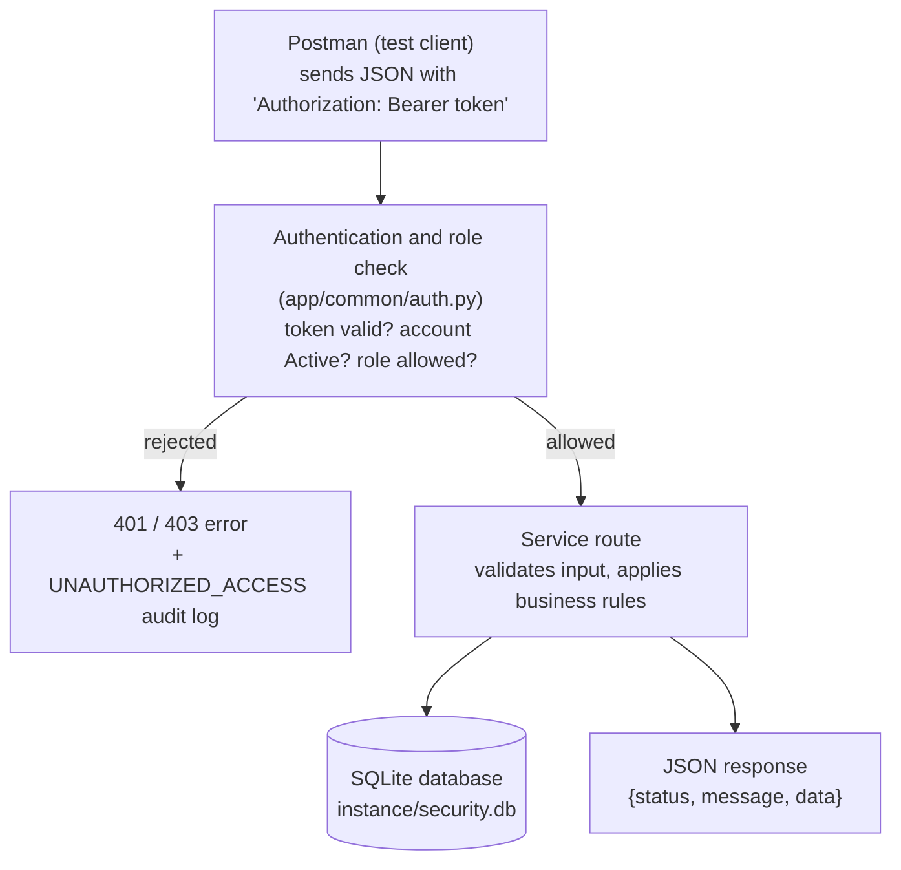
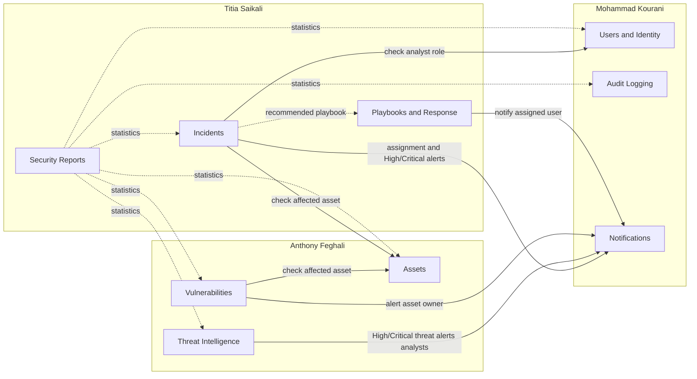
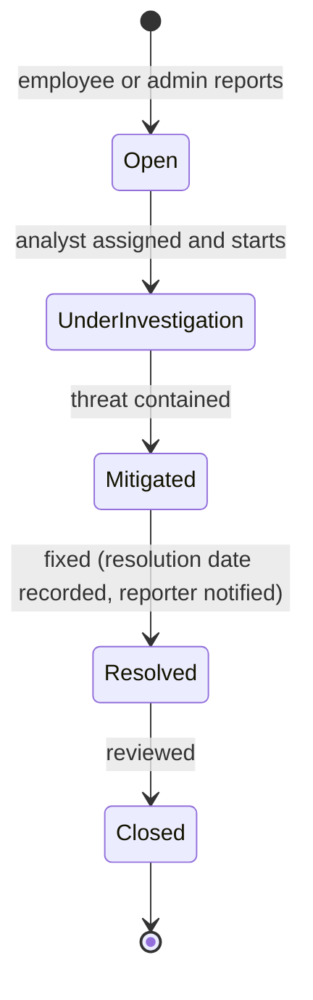

# System architecture

Owner: Titia Saikali

GitHub draws the diagrams below automatically. For the report, open this file on GitHub and take a screenshot of each diagram.

## 1. How a request flows

Every request from Postman passes the same checks before it reaches a service.

## 2. The nine services and how they work together

Solid arrows are calls between services. Dashed arrows are reads only.

Every service also writes to **Audit Logging** through `log_event()` on each create, update, delete, and denied request. Those arrows are left out to keep the diagram readable.

## 3. Incident lifecycle

Each step must follow the previous one; skipping or going backwards is rejected.

## Design choices

- **One Flask application, nine Blueprints:** each service lives in its own folder and is registered automatically. This keeps services independent (separate files, owners, and URL prefixes) without having to run nine servers.
- **Services cooperate through shared functions:** `log_event()` and `create_notification()` act as internal APIs, and each service checks the others' records (does the asset exist? is the user an analyst?) through their models.
- **One shared database:** with foreign keys and `CHECK` constraints, it keeps the data consistent across services.
- **A single security gate:** the same authentication and role check runs for every protected endpoint, so authorization rules cannot be forgotten in one service.
