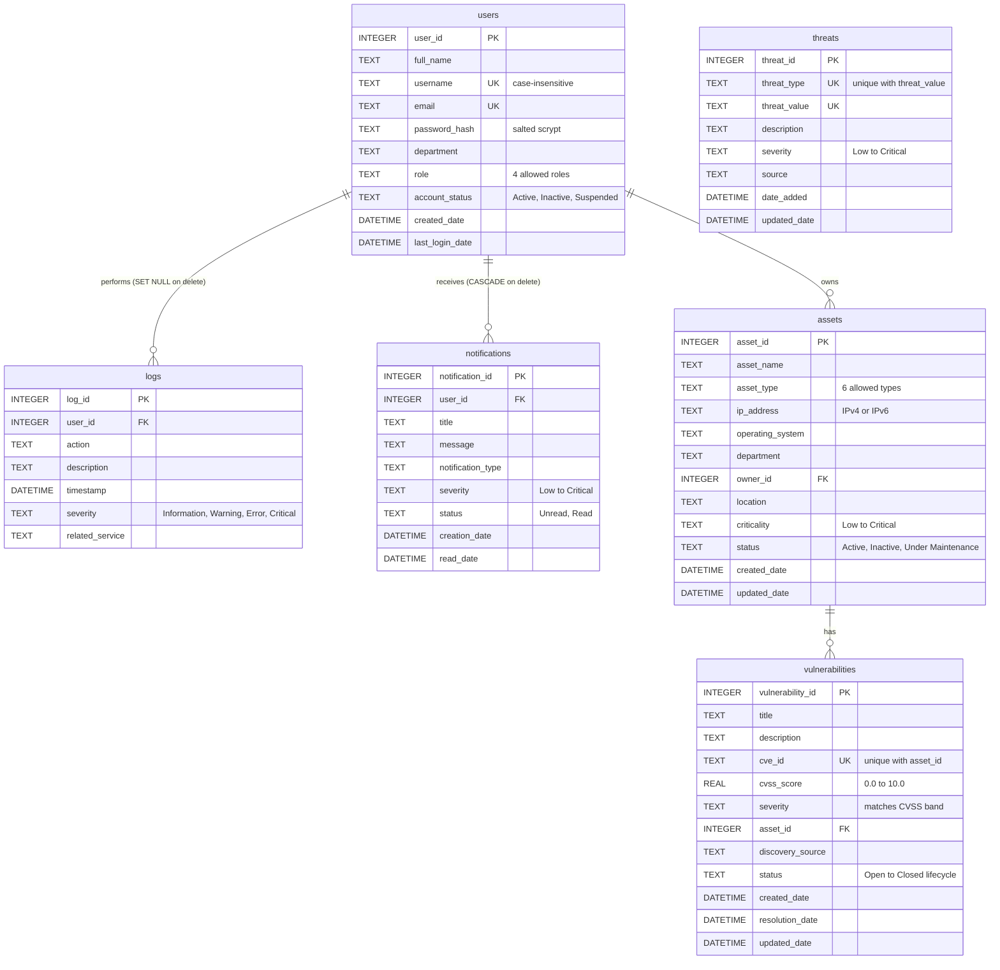

# Database schema

Owner: Anthony Feghali

GitHub draws the diagram below automatically. For the report, open this file on GitHub and take a screenshot of the diagram.

Lines show foreign keys: `||--o{` means "one to many".

**To be added by Titia Saikali:** `incidents` (linked to users as reporter and analyst, and to assets as the affected asset), `investigation_notes`, `playbooks`, and `response_actions`. Add them to the diagram above when `database/03_...sql` is ready.
