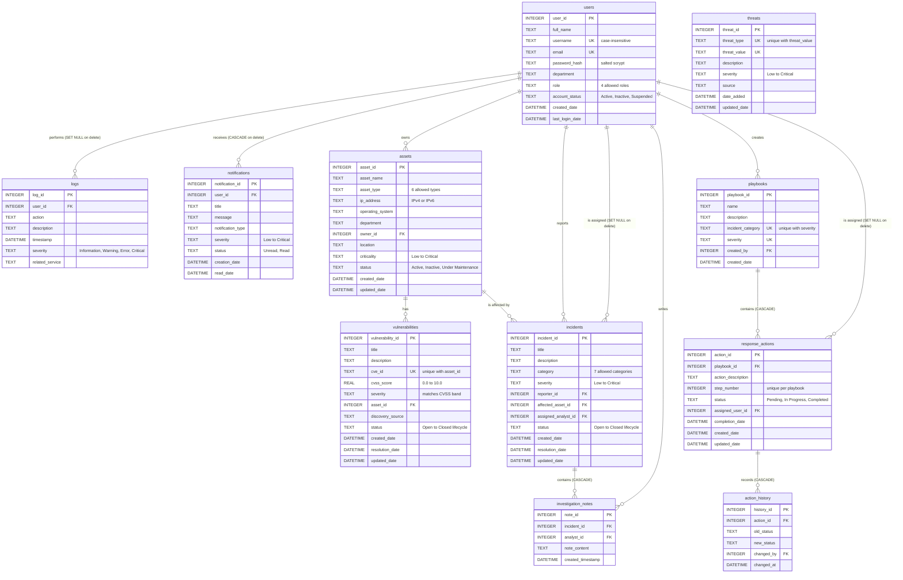

# Database schema

Owner: Anthony Feghali (incident and playbook tables: Titia Saikali)

GitHub draws the diagram below automatically. For the report, open this file on GitHub and take a screenshot of the diagram.

Lines show foreign keys: `||--o{` means "one to many".

The incidents, investigation_notes, playbooks, response_actions, and action_history tables were added by Titia Saikali (`database/03_incidents_playbooks.sql`).
